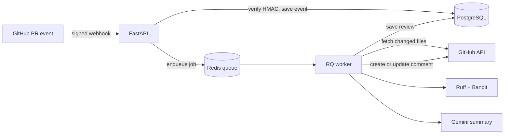
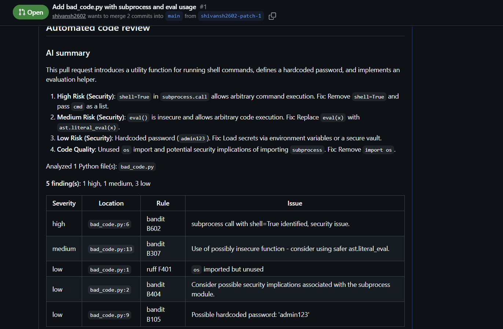

# AI Code Review Platform


A GitHub bot that reviews pull requests automatically. When a PR is opened or updated, the platform downloads the changed Python files, runs static analysis (Ruff and Bandit), asks an LLM (Gemini) for a short review, and posts the result as a PR comment. Later runs on the same PR edit that comment instead of adding new ones.

## Architecture



The webhook handler only verifies, stores and enqueues, so it answers GitHub in milliseconds. The slow work (GitHub downloads, analysis, the LLM call) happens in a separate worker process.

## Example output



## Results

| Metric | Value |
|---|---|
| Median end-to-end review time | 20.8 s (range 11.1 to 37.3 s; 12 runs; 1-file PR; local Docker; free-tier Gemini Lite) |
| Where the time goes (medians) | 4.3 s analysis, 12.9 s LLM call, 1.8 s posting the comment |
| Automated tests | 34 (pytest, run in CI) |
| Findings on the demo PR | 5 (1 high, 1 medium, 3 low) |

## Tech stack

Python 3.13, FastAPI, PostgreSQL, SQLAlchemy, Redis, RQ, Docker Compose, pytest, Ruff, Bandit, Gemini API, GitHub Actions.

## Design decisions

- **Queue instead of inline processing.** Analysis takes several seconds, and GitHub expects a quick webhook reply.
- **Commit, then enqueue.** The event is saved before the job is queued, so the worker can never look for a row that does not exist yet.
- **The LLM is optional.** If Gemini is slow, rate-limited or down, the review still posts with the static-analysis table.
- **Analysis is saved before posting.** If the GitHub comment fails, the review is kept and the event is marked `failed`.
- **Comment updates are idempotent.** The comment id is stored with each review, so a re-run edits the existing comment. If someone deletes it, a new one is posted.
- **Syntax errors are called out.** A file that cannot be parsed gets an explicit warning, so a broken file never looks clean.

## Security

- Webhooks are verified with HMAC-SHA256 and a constant-time comparison. Unsigned or wrongly signed requests get a 401.
- Secrets live in `.env`, which is git-ignored. `.env.example` lists the variables.
- Submitted code is only parsed by static analyzers and is never executed.
- The LLM prompt tells the model to treat the code as untrusted data and ignore instructions inside it. This reduces prompt-injection risk but does not remove it.
- Use a fine-grained GitHub token limited to the repositories you want reviewed.

## Limitations

- Most of the latency is the LLM call. A planned improvement is to post the static-analysis table first and edit in the summary when it arrives.
- Python files only, at most 50 files and 200 KB per file per PR.
- No automatic retry when a GitHub call fails; the event is marked `failed`.
- Tables are created at startup with `create_all`; there are no migrations yet.
- `/reviews` has no authentication. Do not expose it publicly as it is.
- The free Gemini tier may use submitted content to improve Google products, so do not review private code with it.
- Runs locally; a public URL (for example a tunnel) is needed to receive real GitHub webhooks.

## Run it locally

```bash
git clone https://github.com/shivansh2602/ai-code-review-platform.git
cd ai-code-review-platform
cp .env.example .env        # then fill in the values
docker compose up --build -d
```

Required `.env` values: `WEBHOOK_SECRET`, `POSTGRES_USER`, `POSTGRES_PASSWORD`, `POSTGRES_DB`, `GITHUB_TOKEN`, and optionally `GEMINI_API_KEY` and `GEMINI_MODEL`.

Send a signed test event for a real PR:

```bash
python scripts/send_test.py --secret <your WEBHOOK_SECRET> --repo owner/repo --pr 1
```

Review history: `GET http://127.0.0.1:8000/reviews`

## Tests

```bash
pip install -r requirements.txt
ruff check app tests scripts
pytest -v
```
The tests fake GitHub, Redis and Gemini, so they need no network, secrets or Docker.